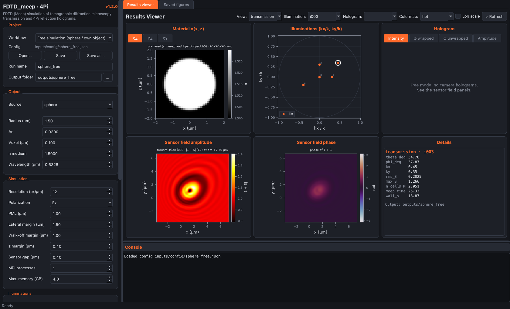

# FDTD_meep GUI

**v1.2.0 · 2026-10-30 · Carlos Chacón** — FDTD (Meep) simulation of tomographic diffraction
microscopy (TDM) acquisitions, including 4Pi transmission and reflection, driven from a PyQt5
interface.



## What it does

From a 3D refractive-index object n(x, y, z) and a list of illumination directions, it uses Meep
to compute the **scattered field** for each illumination. When real holograms are available, it
also produces **synthetic off-axis holograms** (`iNNN.pgm`) with the same optics, orientation and
numbering as the real ones, so the same pipeline can reconstruct them.

- **Free simulation**: a sphere or your own object (`.h5`) plus an illumination list (CSV).
  Transmission and/or reflection. No experimental data needed.
- **4Pi acquisition**: real holograms of both views (bottom/top) → selection → calibration →
  transmission and reflection holograms → real vs simulated comparison.
- **Viewer**: object slices, illumination map (kx, ky), holograms (intensity, wrapped and
  unwrapped phase, amplitude), the field at the sensor, a per-illumination report, and every
  saved figure.

The solver uses the scattered-field formulation (source J = −iω(ε − ε_medium)E_inc on a discrete
Yee plane wave) and has been validated against exact Mie theory. Details:
[docs/DOCUMENTATION.md](docs/DOCUMENTATION.md).

## Requirements

- macOS or Linux (on Windows, use WSL). Meep is installed from conda-forge.
- [micromamba](https://mamba.readthedocs.io/en/latest/installation/micromamba-installation.html),
  mamba or conda. On macOS with Homebrew, the installer installs micromamba for you.
- RAM: under 1 GB for the sphere example; 5–8 GB per illumination for the 4Pi phantom at
  12 px/µm.

## Installation

```bash
git clone https://github.com/carlosalbertoch/FDTD_meep_GUI.git
cd FDTD_meep_GUI
./install.sh        # creates ./.env (Meep 1.34 + MPI + PyQt5) and runs the tests
./run_gui.sh        # opens the interface
```

To install by hand instead: `micromamba create -y -p ./.env -f environment.yml`, then
`./.env/bin/python -m fdtd_meep_gui`.

## Quick start: a sphere and an illumination list (~2 min)

1. **Open the GUI** (`./run_gui.sh`). It loads `inputs/config/sphere_free.json`:
   the *Free simulation* workflow with a sphere of R = 1.5 µm and Δn = 0.03 in a medium of
   n = 1.5, at λ = 0.6328 µm.
2. **Choose the illumination list.** Under *Illuminations → List file*, select
   `inputs/illuminations/sphere_example.csv`, or click **Generate list…** to make a new one
   (number of directions, maximum angle, spiral or rings pattern). The *Illuminations* panel
   plots the directions in (kx/k, ky/k).
3. **Check the parameters.** The example uses 12 px/µm, Ex polarization and 1 MPI process. The
   *Material* panel updates its preview of the object as you change it.
4. **Choose what to simulate.** Under *Process*, tick *Transmission* and/or *Reflection*. The
   step list shows what will run: *Prepare object → Transmission → Reflection*.
5. **Run** with **▶ Run selected steps**. The console prints each illumination
   (`[transmission 3/5] i002 θ=17.5° …`) and the progress bar advances. **■ Stop** cancels
   the run.
6. **Look at the results.** In *Results viewer*, choose a *View* (transmission or reflection)
   and an *Illumination* (i000…). The panels show the field amplitude at the sensor (|1 + S|,
   or |S| in reflection) and its phase, with the report on the right. *Saved figures* lists the
   PNG summaries.

Everything is written to `outputs/sphere_free/`. The GUI also saves the configuration back to
the JSON file, so you can repeat the same run from the command line:

```bash
./.env/bin/python -m fdtd_meep prepare --config inputs/config/sphere_free.json
./.env/bin/python -m fdtd_meep free    --config inputs/config/sphere_free.json
```

## Illumination list format

The list is a CSV file with a header row. Lines that start with `#` are comments. Each row is one
illumination, and they are simulated in file order. Use **one** of these column sets:

| Columns | Meaning | Mode |
|---|---|---|
| `kx, ky` | Transverse direction cosines kx/k and ky/k, with k = 2π·n_medium/λ. kx² + ky² must be < 1 | Free and 4Pi |
| `theta_deg, phi_deg` | Polar and azimuthal angles in the medium: kx = sin θ cos φ, ky = sin θ sin φ | Free and 4Pi |
| `filename` | A real hologram of the view (`i232.pgm`) | 4Pi only |

The optional `name` column sets the output name. Without it, the names are `i000`, `i001`, … in
file order. The `illumination_positions.csv` file written by the *Select* step is also accepted
as is.

```csv
# inputs/illuminations/sphere_example.csv
name,kx,ky
i000,0.00,0.00
i001,0.30,0.00
i002,0.00,0.30
i003,0.45,0.35
i004,-0.40,-0.20
```

- **Free mode**: (kx, ky) are given in the object frame, and the light enters through the z-min
  face. See `sphere_example.csv` (kx, ky) and `sphere_example_angles.csv` (θ, φ).
- **4Pi mode**: (kx, ky) follow the RAW camera convention of each view, as in `seleccion.txt`
  (+dcol → +kx, +drow → +ky). Each direction is matched to the real hologram with the closest
  specular peak, and no hologram is used twice. With `filename`, the named hologram is used
  directly (see `phantom_bottom_by_file.csv`). To use lists, set *Selection → From list file*
  and give one list per view.

## Working with real 4Pi data

1. Put one folder per view in `inputs/holograms/`, with `config_manip.txt`,
   `Intensite_ref.pgm` and `iNNN.pgm`, exactly as the acquisition system writes them.
2. In the GUI, choose *Workflow → 4Pi acquisition*, select the *Bottom view* and *Top view*
   folders, and choose the object: `registered_gt` (a `.mat` with Δn) or `voxel_h5`. λ, N0 and
   NA are read from `config_manip.txt` and shown under the folders. The medium index is taken
   from the object file, with no correction. The crop around the object can be left automatic
   (**Auto**). You do not flip the object for the second view: *Calibrate* does it (see
   [docs/GUIDE.md](docs/GUIDE.md#object)).
3. Choose the illuminations. *Automatic (FPS)* takes the N most uniformly spread directions of
   each view. *From list file* uses your own lists.
4. Tick *Transmission* and/or *Reflection* and run. Each step is a command-line command:

| Step | Command | Writes (in `outputs/<run>/`) |
|---|---|---|
| Prepare object | `prepare` | `object/object.h5` |
| Select illuminations | `select` | `<view>/selection/`, `<view>/real_subset/` |
| Estimate memory | `estimate` | a table in the console |
| Calibrate object → camera | `calibrate` | `calibration/calibration.{json,png}` |
| Transmission bottom/top | `run --view` | `<view>/fields/`, `<view>/sim_subset/` |
| Reflection refl_top/refl_bottom | `reflect --view` | `refl_*/fields/`, `refl_*/camera_fields/`, `refl_*/sim_subset*/` |
| Compare real vs simulated | `compare` | `comparison/comparison.{png,json}` |
| Lateral reference views | `reference` | `reference_views/*.{png,svg}` |

`inputs/config/phantom_4pi_subset.json` is ready to use with the 32 + 32 phantom holograms in
`inputs/holograms/phantom_4pi/`. These data are not in the repository: the data folders are
git-ignored.

Runs can be resumed: illuminations whose field already exists are skipped. To browse the results
of an earlier run, set *Output folder* to that run's folder; the viewer only reads files.

In 4Pi reflection, `refl_top` uses the illuminations of the *bottom* transmission and the *top*
camera, and `refl_bottom` the reverse. At 12 px/µm, reflection results are qualitative: the
amplitude of each interface is within a factor of ~0.4–2, and the phase within ±0.7 rad.

## Project layout

```
FDTD_meep_GUI/
├── fdtd_meep/          simulation core and command line (python -m fdtd_meep …)
├── fdtd_meep_gui/      PyQt5 interface (python -m fdtd_meep_gui)
├── inputs/
│   ├── config/         run configurations (JSON)
│   ├── illuminations/  illumination lists (CSV)
│   ├── holograms/      real acquisitions (git-ignored)
│   ├── objects/        voxel objects .h5 (git-ignored)
│   └── phantom/        registered ground truth .mat (git-ignored)
├── outputs/            results (git-ignored)
├── docs/               technical documentation, GUI guide, images
├── matlab/             illumination selection and object export from MATLAB
├── tests/
└── environment.yml · install.sh · run_gui.sh
```

## Documentation

- [docs/GUIDE.md](docs/GUIDE.md): the GUI panel by panel, its parameters, and troubleshooting.
- [docs/DOCUMENTATION.md](docs/DOCUMENTATION.md): method, conventions, every JSON parameter,
  and validation.
- [docs/OUTPUTS.md](docs/OUTPUTS.md): every output file and how to open it.
- [docs/RESOURCES.md](docs/RESOURCES.md): measured memory and run times for the phantom.
- [CHANGELOG.md](CHANGELOG.md).

## Known limitations

- The camera field is scalar (main component only); the real polarization of the setup is
  unknown.
- Synthetic holograms have no noise or speckle, and the illumination is an ideal plane wave.
- An empirical modulus factor from the Mie comparison (1.19 at 12 px/µm) is applied to E_s in
  `run` and `reflect`. It is under review; see
  [docs/DOCUMENTATION.md](docs/DOCUMENTATION.md#known-limitations).

## License

[MIT](LICENSE) © 2026 Carlos Chacón. Meep is distributed under its own license (GPL-2.0).
